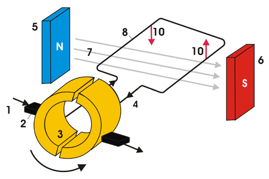

# Silnik Elektryczny
## Przykładowy model silnika:

1. kierunek prądu, 
2. szczotka węglowa, 
3. komutator, 
4. kierunek prądu w wirniku, 
5. biegun północny pola magnetycznego wytwarzanego przez uzwojenie, 
6. biegun południowy pola magnetycznego wytwarzanego przez uzwojenie, 
7. linie pola magnetycznego, 
8. wirnik, 
9. kierunek obrotu wirnika, 
10. siła elektrodynamiczna

## Dane do modelu silnika w programie
| Kategoria                           | Parametr                   |   Symbol   | Jednostka (SI) | Opis fizyczny                                           |
|:------------------------------------|:---------------------------|:----------:|:--------------:|:--------------------------------------------------------|
| **Geometria i masa ramki**          | Szerokość ramki            |    $a$     |   $\text{m}$   | Bok prostopadły do osi obrotu (wpływa na ramię siły)    |
|                                     | Długość ramki              |    $b$     |   $\text{m}$   | Bok równoległy do osi obrotu (działa na niego siła $F$) |
|                                     | Pole powierzchni ramki     |    $S$     |  $\text{m}^2$  | Powierzchnia pętli ($S = a \cdot b$)                    |
|                                     | Masa całkowita ramki       |    $m$     |  $\text{kg}$   | Całkowita masa drutu tworzącego ramkę ($20\text{ g}$)   |
| **Parametry elektromagnetyczne**    | Liczba zwojów              |    $N$     |      $-$       | Liczba nawiniętych pętli przewodu                       |
|                                     | Natężenie prądu            |    $I$     |   $\text{A}$   | Prąd płynący przez uzwojenie                            |
|                                     | Indukcja magnetyczna       |    $B$     |   $\text{T}$   | Wartość zewnętrznego pola magnetycznego stojana         |
| **Parametry symulacji numerycznej** | Krok czasowy               | $\Delta t$ |   $\text{s}$   | Skok czasu całkowania metodą Eulera ($1\text{ ms}$)     |
|                                     | Całkowity czas symulacji   | $t_{\max}$ |   $\text{s}$   | Horyzont czasowy symulacji                              |
| **Warunki początkowe ($t = 0$)**    | Kąt początkowy             | $\alpha_0$ |  $\text{rad}$  | Położenie startowe wirnika (poziomo w polu)             |
|                                     | Początkowa prędkość kątowa | $\omega_0$ | $\text{rad/s}$ | Prędkość obrotowa na starcie (silnik stoi)              |

## Użyte wzory
### Moment siły
$$
M(\alpha) = N \cdot I \cdot S \cdot B \cdot \sin(\alpha)
$$
### Moment bezwładności ramki
-Dwa boki o długości \ (b\) znajdują się w stałej odległości \ (r = \frac {a} {2} \) od osi obrotu:

$$
J_b = 2 \cdot \left (m_b \cdot \left (\frac {a} {2} \right) ^2\right)
$$

-Dwa boki o długości \ (a\) obracają się wokół swojego środka (dla pręta o masie \ (m_a\) i długości \ (a\)):

$$
J_a = 2 \cdot \left (\frac {1} {12} m_a^2\right)
$$

-Całkowity moment bezwładności jest sumą momentów obu par boków:

$$
J = J_a + J_b
$$
### Przyśpieszenie kątowe:
$$
\varepsilon = \frac{M}{J}
$$


## Działanie kodu
### init:
```
void init(
double szerokość,
double wysokość,
double masa,
double liczbaZwojow,
double natezeniePradu,
double indukcjaMagnetyczna,
double czasTrwania) {
```
Inicjalizuje/startuje program. Powinna być na początku programu

**Następujące funkcje używają wzorów z wcześniej**
### obliczanie bezwładności:
```
static void obliczMomentBezwładności() 
    double masaSzerokosc = masaCalkowita*(szerokosc/(2.0*szerokosc + 2.0*wysokosc));
    double masaWysokosc = masaCalkowita*(wysokosc/(2.0*szerokosc + 2.0*wysokosc));
    
    double JWysokosc = 2.0*(masaWysokosc*pow(szerokosc/2.0, 2.0));
    double JSzerokosc = 2.0*((1.0/12.0)*masaSzerokosc*pow(szerokosc,2.0));
    J = JWysokosc + JSzerokosc;
}
```
### Obliczanie momentu siły i komutator:
**Komutator w silniku elektrycznym stale przełącza kierunek prądu w uzwojeniach wirnika podczas jego obrotu, co pozwala utrzymać ciągły ruch obrotowy w jedną stronę.**
```
void obliczMomentSiły() {
    M = N*komutator(alfa, I)*(szerokosc*wysokosc)*B*sin(alfa);
}

static double komutator(double alfa1, double I1) {
    if (sin(alfa1) >= 0) {
        return I1;
    }
    return -I1;
}
```
### Przyśpieszenie Kątowe:
w tej funkcji obliczamy też prędkość kątową i kąt obrotu ramki w następnym kroku
$$
\omega _{i+1} = \omega_i + \varepsilon_i \cdot \Delta t
\alpha _{i+1} = \alpha_i + \omega_i \cdot \Delta t
$$
```
static void obliczPrzyspieszenieKatowe() {
    przyspieszenieKatowe = M/J;

    W = W+przyspieszenieKatowe*Tkrok;

    alfa = alfa + W*Tkrok;
}
```

### Funkcja oblicz
Łączy dwie poprzednie funkcje dla czytelności
```
void oblicz() {
    obliczMomentSiły();
    obliczPrzyspieszenieKatowe();

    T = T + Tkrok;
}
```

`T = T + Tkrok;` ten kawałek kodu przesuwa czas o 10 ms, ponieważ krok czasowy jest ustawiony na tą wartość

## Jak używać

1. wklej pliki `silnikElektrzynczy.c` i `silnikElektryczny.h`
2. dodaj te dwa pliki do `CMakeLists.txt` w `add_executable`. tak jak w tym repozytorium [`CMakeLists.txt`](https://github.com/dawidekszopen/SilnikElektryczny/blob/master/CMakeLists.txt)
3. daj na początku programu `#include "silnikElektryczny.h"`

## Przykładowe użycie
```
#include <stdio.h>
#include "silnikElektryczny.h"
#include <math.h>

int main(void) {

    init(0.05, 0.08, 0.02, 50, 1.5, 0.2, 2);
    printf("T[s] \t M[N*m] \t ε[rad/s^2] \t W[rad/s] \t α \t v \n");
    while (czyCzasSieSkonczyl()) {
        oblicz();
        printf("%.2f \t %f \t %f \t %f \t %f\n", dajT(), dajM(), dajPrzyspieszenieKatowe(), dajW(), fmod(dajAlfa(), 360.0));
    }

    return 0;
}
```